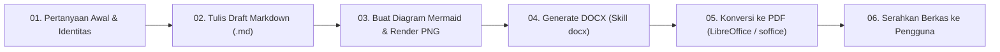

# Penulisan Tugas Akademik (Markdown, DOCX & PDF)

Panduan standar penulisan dokumen akademik ketikan formal (laporan tugas, UTS, UAS, praktikum, makalah, resume perkuliahan/renti, proposal perkuliahan) dengan menghasilkan draft Markdown (`.md`) sebagai sumber konten terstruktur, diagram arsitektur/alur berbasis **Mermaid**, konversi/penerbitan ke **Microsoft Word (`.docx`)** yang terintegrasi dengan **skill `docx`**, serta ekspor ke **PDF** berkualitas tinggi dengan tata letak rapi, tabel terstruktur, dan tipografi ilmiah standar universitas di Indonesia.

> **Catatan Pemisahan Skill:**
> - Gunakan skill ini (**`penulisan-tugas`**) untuk tugas perkuliahan ketikan formal dalam format Markdown, Word (`.docx`), dan PDF (`.pdf`) dengan diagram Mermaid, tabel terproteksi, dan perataan teks rata kanan-kiri (justify).
> - Untuk tugas perkuliahan yang dikerjakan pada lembar **kertas folio bergaris dengan gaya tulisan tangan** (*handwritten folio*), gunakan skill **`penulisan-tugas-tulis-tangan`**.
> - Untuk riset ide, penelusuran 5–7 jurnal terakreditasi, analisis *Research GAP*, perancangan arsitektur sistem, dan penyusunan naskah proposal **Tugas Akhir / Skripsi**, gunakan skill khusus **`pengajuan-judul-skripsi`**.
> - Untuk penyusunan Laporan Kerja Praktek UNUSIDA yang wajib mengikuti buku panduan akademik kampus, gunakan skill **`laporan-kerja-praktek-unusida`**.
> - Untuk manipulasi mendalam, scripting pembuatan file Word tingkat lanjut, atau bedah XML dokumen Word, relasikan secara langsung ke skill **`docx`**.

---

## 0. Pertanyaan Awal Sebelum Mengerjakan (Wajib)

Sebelum mulai menulis atau memformat, ajukan **satu set pertanyaan terstruktur di awal** kepada pengguna (digabung sekaligus dalam satu pesan, bukan ditanya bertahap), dan jangan mulai menulis sebelum jawabannya diterima. Cakupan minimal:

1. **Jenis tugas:** laporan tugas, UTS/UAS, praktikum, makalah, resume perkuliahan (renti), atau proposal.
2. **Identitas akademik:** nama lengkap, NIM, program studi/kelas, mata kuliah, dan dosen pengampu.
3. **Format & Berkas Target:** konfirmasi format luaran yang diinginkan (`.docx`, `.pdf`, atau keduanya) serta nama berkas yang diharapkan.
4. **Struktur konten & diagram:** jumlah soal/bab yang dikerjakan, topik studi kasus yang dianalisis, serta diagram Mermaid yang dibutuhkan (misal flowchart, sequence diagram, ERD).
5. **Kebutuhan Daftar Pustaka (Opsional):** apakah tugas mewajibkan pencantuman bab Daftar Pustaka / Referensi formal (format APA 7th Edition) atau tidak diperlukan (misalnya untuk resume materi kuliah/renti mandiri).
6. **Batasan lain:** target panjang bahasan/halaman, bahasa, dan gaya penulisan khusus.

Lewati pertanyaan yang jawabannya sudah jelas dari permintaan pengguna atau berkas yang dirujuk; sisa pertanyaan digabung dalam satu pesan. Setelah jawaban lengkap, barulah lanjut ke alur kerja penulisan pada bagian 10.

---

## 1. Standar Tipografi dan Tata Letak Dokumen (DOCX & PDF)

### a. Ukuran Halaman & Margin
- **Ukuran Kertas Dokumen:** A4 (`210 mm x 297 mm` / `11906 x 16838 DXA`).
- **Margin Dokumen:** 2.54 cm (1 inci / `1440 DXA` / `72 pt`) di semua sisi (Atas, Bawah, Kiri, Kanan).
- **Jenis Huruf Utama:** Times New Roman (standar umum universitas dan instansi di Indonesia) atau Arial / Calibri.
- **Warna Teks Utama:** Hitam pekat atau Dark Charcoal (`#222222`).

### b. Skema Hirarki Font & Spasi
| Elemen | Ukuran Font | Gaya & Warna | Perataan (Alignment) | Spasi Sebelum / Sesudah |
| :--- | :---: | :--- | :---: | :---: |
| **Judul Dokumen (`#`)** | 14 pt | Bold, Navy Gelap (`#0F2537`) | Rata Tengah (Center) | 6 pt / 3 pt |
| **Sub-Judul (`##`)** | 12 pt | Bold, Slate (`#2C3E50`) | Rata Tengah (Center) | 2 pt / 8 pt |
| **Judul Bab / Bagian (`###`)** | 12 pt | Bold, Navy (`#1B365D`) | Rata Kiri (Left) | 10–12 pt / 3 pt |
| **Sub-Bab / Butir (`####`)** | 11 pt | Bold, Navy (`#1B365D`) | Rata Kiri (Left) | 6–8 pt / 2 pt |
| **Paragraf Isi (Body Text)** | 11 pt | Regular, Hitam (`#222222`) | **Rata Kanan-Kiri (Justify)** | 0 pt / 3 pt (1.15 line) |
| **Poin Nomor (`1. `, `2. `)** | 11 pt | Nomor Bold Navy, teks Regular | **Rata Kanan-Kiri (Justify)** | 2 pt / 1.5 pt |
| **Sub-Bullet (`– ` atau `• `)** | 11 pt | Bullet Bold Navy, teks Regular | **Rata Kanan-Kiri (Justify)** | 1.5 pt / 1.5 pt |
| **Teks Sel Tabel** | 10 pt | Header Bold Putih, Isi Regular | Center / Left | Padding kompak |
| **Keterangan Gambar (Caption)**| 9.5 pt | Italic, Abu-abu (`#475569`) | Rata Tengah (Center) | 2 pt / 6 pt |
| **Daftar Pustaka (Opsional)**| 10 pt | Regular, Hanging Indent | **Rata Kiri (Left / Ragged Right)** | 2 pt / 3 pt |

### c. Tata Letak Judul, Nama, NIM, dan Identitas Awal (Mode A — Tanpa Halaman Sampul)
Dokumen menggunakan **Mode A** (header identitas ringkas langsung di halaman 1 tanpa *cover page* terpisah) dengan struktur berurutan dari atas ke bawah:
1. **Blok Judul Dokumen:**
   - **Judul Utama:** 14 pt, Bold, Navy Gelap (`#0F2537`), Rata Tengah (`Center`).
   - **Sub-Judul / Nama Mata Kuliah:** 12 pt, Bold, Slate (`#2C3E50`), Rata Tengah (`Center`).
2. **Tabel Identitas 3 Kolom:**
   - Gunakan tabel 3 kolom rapi tanpa border luar:
     - Kolom Label (`~22%`): `Nama Lengkap`, `NIM`, `Program Studi / Kelas`, `Mata Kuliah`, `Dosen Pengampu` (Bold, Navy `#1B365D`, rata kiri).
     - Kolom Pemisah (`~4%`): `:` (rata tengah).
     - Kolom Nilai (`~74%`): isi identitas (Regular, `#222222`, rata kiri). Gunakan *Title Case* untuk nama dan format konsisten untuk NIM.
   - Untuk tugas kelompok, cantumkan tabel info mata kuliah diikuti sub-tabel daftar anggota (`No` | `Nama Lengkap` | `NIM`).
3. **Garis Pemisah Penutup Identitas:**
   - Tepat di bawah tabel identitas, sisipkan garis horizontal pemisah sebelum masuk ke bab/bagian/soal pertama.
4. **Sinkronisasi Identitas:**
   - Nama, NIM, dan Mata Kuliah pada blok identitas wajib identik dengan judul dokumen dan header Word/PDF.

---

## 2. Hirarki Indentasi dan Format Paragraf

1. **Paragraf Normal / Pengantar:**
   - `alignment = JUSTIFY` (Rata Kanan-Kiri).
   - Jarak antar baris 1.15 line.
2. **Poin Bernomor (`1. `, `2. `):**
   - Angka nomor duduk rapi di margin kiri, teks judul poin diberi penekanan tebal (Bold Navy).
   - Teks penjelas di bawah poin bernomor wajib sejajar dengan teks poin, bukan melompat kembali ke batas terluar margin kiri.
3. **Sub-Bullet di Bawah Poin Bernomor:**
   - Menggunakan penanda bullet standar yang konsisten (`-` atau `•`).
4. **Daftar Pustaka / Referensi (APA 7th — Bersifat Opsional):**
   - Jika pengguna/tugas mensyaratkan adanya rujukan pustaka, gunakan format **Hanging Indent** dengan perataan **Rata Kiri (Left / Ragged Right)**. Hindari *Justify* pada daftar pustaka yang memuat URL/DOI panjang guna mencegah spasi antarkata yang renggang janggal (*typographical rivers*).
   - Jika tugas bersifat resume materi/catatan kuliah internal yang tidak mensyaratkan pustaka luar, bagian ini dapat dilewati sesuai instruksi pengguna.

---

## 3. Pencegahan Artefak Markdown

1. **Pembersihan Asterisk & Tanda Baca Bocor:**
   - Pastikan tanda bintang (`*`) untuk format tebal (`**bold**`) atau miring (`*italic*`) tertutup sempurna dan tidak bocor ke kalimat berikutnya (*italic bleed*).
   - Tautan URL markdown `[Teks](url)` dipastikan bersih saat dikonversi ke DOCX.
2. **Format Istilah Teknis (Inline Code):**
   - Istilah teknis (nama berkas, variabel, sintaks kode, protokol) dicetak menggunakan font berbobot **Bold** dengan warna Navy Gelap (`#1B365D`), bukan warna merah/pink kontras bergaya blog yang merusak estetika naskah ilmiah formal.

---

## 4. Standar Diagram & Visualisasi Berbasis Mermaid

### Larangan Keras:
- **Dilarang keras menggunakan teks ASCII art mentah** (karakter `┌─┐│└┘`, tanda panah monospace `--->`, atau kotak karakter `+---+`) untuk diagram arsitektur atau alur pada dokumen formal.
- **Dilarang menyalin gambar tangkapan layar (screenshot) beresolusi rendah** atau gambar dengan watermark pihak ketiga.
- **Dilarang melakukan hardcode dimensi gambar secara terpisah tanpa menjaga rasio aspek alami (*aspect ratio*)**, karena akan menyebabkan gambar tampak pipih/gepeng atau tertarik lonjong secara tidak wajar.

### Standar Pembuatan Diagram Mermaid:
Semua diagram didefinisikan secara deklaratif menggunakan **Mermaid syntax** di dalam naskah Markdown:

1. **Tipe Diagram dan Orientasi Layout yang Dianjurkan:**
   - **Prioritas Orientasi Horizontal (`flowchart LR`):** Untuk dokumen berorientasi potret (A4 portrait), utamakan diagram alur horizontal (`flowchart LR`) agar mengisi lebar margin secara proporsional (~500–560 pt). Hindari diagram vertikal menjulang (`flowchart TD`) dengan banyak tingkatan bertingkat karena akan menghasilkan gambar yang sangat tinggi dan sempit ($<450\text{ px}$ lebar vs $>1400\text{ px}$ tinggi), yang rawan mengalami distorsi saat disematkan.
   - `flowchart TD`: Gunakan hanya untuk alur bertingkat pendek (2–3 level) atau struktur piramida melebar.
   - `sequenceDiagram`: Untuk interaksi antarkomponen/layanan, siklus tahapan.
   - `erDiagram`: Untuk skema relasi basis data.
   - `stateDiagram-v2`: Untuk pemodelan siklus hidup (*lifecycle*), transisi kondisi kognitif/perilaku.
   - `classDiagram`: Untuk diagram kelas berorientasi objek (OOP).

2. **Aturan Sintaksis & Keterbacaan Mermaid:**
   - **Kutip Semua Label Khusus:** Node yang memuat tanda kurung, garis miring, titik dua, atau simbol khusus WAJIB diapit tanda kutip dua:
     ```mermaid
     flowchart TD
         client["Klien (Web / Mobile)"] --> apiGw["API Gateway (Express.js)"]
         apiGw --> authSvc["Layanan Autentikasi (JWT)"]
         apiGw --> coreDb[("PostgreSQL Database")]
     ```
   - **Label Alur Data yang Jelas:** Gunakan teks pada edge panah untuk memperjelas alur:
     ```mermaid
     A -->|"Stimulus"| B
     B -->|"Respon"| C
     ```
   - **Palet Warna Elegan / Korporat:** Gunakan skema warna akademik/korporat yang konsisten (Navy, Slate, Emerald, Teal) dengan kontras teks tinggi:
     ```mermaid
     classDef navy fill:#1B365D,stroke:#0F2537,stroke-width:1.5px,color:#FFFFFF;
     classDef slate fill:#F1F5F9,stroke:#64748B,stroke-width:1.5px,color:#1E293B;
     classDef success fill:#0F6B4F,stroke:#0A4B37,stroke-width:1.5px,color:#FFFFFF;
     ```

3. **Alur Render Diagram dan Aturan Preservasi Rasio Aspek (Anti-Gepeng):**
   - Diagram Mermaid disimpan di dalam berkas Markdown tugas sebagai blok kode ````mermaid ... ````.
   - Untuk disematkan ke DOCX / PDF, diagram Mermaid dirender menjadi berkas gambar PNG beresolusi tinggi (min 300 DPI atau skala 2x–3x):
     - Simpan diagram di folder proyek: `<proyek>/diagram/<slug-tugas>-<nomor-diagram>.png`.
     - Render dapat dilakukan melalui tool CLI Mermaid (`mmdc`), script headless Chromium, atau API generator gambar Mermaid beresolusi tinggi (misal Kroki / Mermaid.ink).
   - **Kaidah Skala Proporsional di Word (`docx` ImageRun):**
     Saat menyematkan gambar ke dokumen Word, tinggi gambar (`height`) WAJIB dihitung secara matematis berdasarkan rasio aspek asli berkas PNG agar tidak gepeng:
     $$\text{height} = \text{targetWidth} \times \left(\frac{\text{nativeHeight}}{\text{nativeWidth}}\right)$$
     *(Contoh: Jika lebar target = 560 pt dan gambar asli 998 x 379 px, maka tinggi target = `Math.round(560 * (379 / 998)) = 213 pt`)*.
   - Di naskah Markdown, cantumkan referensi gambar lokal:
     ```markdown
     
     *Gambar 1. Arsitektur Sistem Layanan Berbasis Microservices.*
     ```

4. **Penyisipan & Narasi Pendukung di Dokumen:**
   - Setiap diagram **wajib** memiliki nomor gambar dan *caption* formal miring di bawahnya, rata tengah.
   - **Wajib Narasi Analitis:** Sertakan minimal **1–2 paragraf narasi analitis** tepat di bawah gambar yang mengulas makna alur, komponen, dan interaksi yang digambarkan. Dilarang meletakkan diagram tanpa penjelasan tertulis.

---

## 5. Standar Format Tabel

Tabel harus tersaji profesional, bersih, dan nyaman dibaca:
1. **Header Tabel:**
   - Latar belakang berwarna Navy Gelap (`#1B365D`), teks Putih Bold (`#FFFFFF`), rata tengah.
2. **Baris Data & Garis:**
   - Format baris bergantian (*zebra striping* lembut jika didukung) atau latar putih bersih dengan border horizontal tipis warna abu-abu netral (`#CBD5E1`).
   - Teks rata kiri untuk uraian deskriptif, rata tengah untuk nomor, tanggal, status singkat, atau persentase.
3. **Penerapan Dimensi Tabel di DOCX (Panduan Skill `docx`):**
   - Tetapkan lebar ganda: `columnWidths` pada tabel dan `width` pada setiap cell menggunakan satuan DXA (`WidthType.DXA`).
   - Total lebar kolom harus sama dengan lebar area teks (misal A4 dengan margin 1 inci = `11906 - 2880 = 9026 DXA`).
   - Gunakan `ShadingType.CLEAR` untuk pewarnaan latar tabel (jangan `SOLID`).

---

## 6. Header, Footer, dan Penomoran Halaman di DOCX & PDF

1. **Running Header (Kanan Atas):**
   - Format: `[Judul Tugas / Mata Kuliah]  |  [Nama Mahasiswa - NIM]`
   - Font: 8.5–9 pt, Miring (*Italic*), warna abu-abu netral (`#64748B`).
2. **Running Footer (Kanan Bawah):**
   - Format: `[Nama Institusi / Program Studi]   —   Halaman [Page] dari [Total]`
   - Font: 8.5–9 pt, warna abu-abu netral (`#64748B`).

---

## 7. Penulisan Makalah Ilmiah & Studi Kasus Perkuliahan

Untuk penugasan analisis studi kasus atau penyusunan naskah makalah akademik perkuliahan:
1. **Identitas Dokumen (Mode A):** Blok judul rata tengah dan tabel identitas 3 kolom (Nama, NIM, Program Studi/Kelas, Mata Kuliah, Dosen Pengampu) beserta garis pemisah di awal halaman 1 tanpa halaman sampul terpisah.
2. **Pendahuluan / Latar Belakang:** Deskripsi kasus, konteks permasalahan, atau urgensi fenomena yang ditelaah.
3. **Kajian Pustaka & Landasan Teori:** Kutipan konsep dan teori ilmiah yang diparafrasakan bebas plagiasi.
4. **Pembahasan & Desain Solusi:** Pembahasan analitis yang dilengkapi tabel komparasi serta diagram Mermaid visual yang informatif.
5. **Kesimpulan & Daftar Pustaka (Opsional):** Ringkasan capaian serta daftar rujukan format APA 7th Edition rata kiri (apabila tugas mewajibkan daftar pustaka).

---

## 8. Penugasan Kolektif / Multi-Mahasiswa

Bila pengguna meminta pengerjaan tugas perkuliahan untuk lebih dari satu mahasiswa secara bersamaan:
1. **Diferensiasi Kasus / Objek Analisis:**
   - Wajib membedakan studi kasus, arsitektur, parameter data, atau skenario implementasi untuk masing-masing mahasiswa agar karya bersifat orisinal dan tidak terindikasi kesamaan tugas.
2. **Pemisahan Dokumen:**
   - Hasilkan berkas Markdown (`.md`), Word (`.docx`), dan PDF (`.pdf`) terpisah dengan penamaan formal yang memuat nama lengkap serta NIM masing-masing mahasiswa.

---

## 9. Prosedur Pembuatan DOCX & PDF (Relasi ke Skill `docx`)

Penerbitan dokumen formal dalam format Word (`.docx`) dan PDF (`.pdf`) mengacu pada pedoman teknis skill **`docx`**:

### a. Pembuatan Dokumen DOCX via Script `docx` (npm) dengan Auto-Scaling Gambar
Gunakan pustaka JavaScript `docx` sesuai petunjuk dalam skill `docx`. Sertakan fungsi pembaca dimensi gambar otomatis agar gambar tidak terdistorsi/gepeng:
```javascript
const { Document, Packer, Paragraph, TextRun, Table, TableRow, TableCell, WidthType, ShadingType, AlignmentType, ImageRun } = require('docx');
const fs = require('fs');

// Helper membaca dimensi asli PNG untuk menjaga Aspect Ratio (Anti-Gepeng)
function getImageDimensions(buffer, targetWidth = 560) {
  const nativeW = buffer.readUInt32BE(16);
  const nativeH = buffer.readUInt32BE(20);
  const targetHeight = Math.round(targetWidth * (nativeH / nativeW));
  return { width: targetWidth, height: targetHeight };
}

// Gunakan pada ImageRun:
const imgDim = getImageDimensions(imgBuffer, 560);
new ImageRun({
  data: imgBuffer,
  transformation: { width: imgDim.width, height: imgDim.height },
  type: "png",
});
```
Jalankan script untuk mengompilasi berkas:
```bash
node generate_doc.js
```

### b. Pembuatan Dokumen DOCX via Pandoc (Markdown → DOCX)
Sebagai alternatif yang cepat dan terstruktur dari berkas Markdown:
```bash
pandoc tugas.md -o tugas.docx --reference-doc=template.docx
```
> Gunakan `reference-doc` dengan styling tabel Navy dan font Times New Roman 11pt justify.

### c. Konversi DOCX ke PDF Berkualitas Tinggi
Untuk menghasilkan berkas `.pdf` siap cetak dan siap unggah ke portal kampus / LMS:
1. **Menggunakan LibreOffice Headless:**
   ```bash
   soffice --headless --convert-to pdf tugas.docx
   ```
2. **Menggunakan Script Helper Skill `docx`:**
   ```bash
   python /home/w4nn/.agents/skills/docx/scripts/office/soffice.py --headless --convert-to pdf tugas.docx
   ```

---

## 10. Alur Kerja Markdown → Mermaid → DOCX → PDF

Proses pengerjaan tugas mengikuti siklus terpadu berikut:



1. **Susun Draft Markdown:** Tulis seluruh naskah akademik secara komprehensif ke dalam berkas `.md` dengan hirarki heading, tabel, format identitas Mode A, dan blok kode diagram Mermaid (diutamakan `flowchart LR`).
2. **Render Diagram Mermaid:** Render blok Mermaid menjadi berkas PNG beresolusi tinggi (300 DPI) di folder `diagram/`.
3. **Generate DOCX:** Bangun dokumen Microsoft Word (`.docx`) yang mematuhi pedoman tipografi dan tata letak dari skill `docx` (ukuran A4, margin 2.54 cm, tabel ber-header Navy, teks justify, serta penskalaan dimensi gambar proporsional anti-gepeng).
4. **Ekspor ke PDF:** Konversi berkas `.docx` menjadi `.pdf` menggunakan LibreOffice headless untuk menjamin hasil tata letak 100% konsisten.
5. **Serahkan ke Pengguna untuk Review:** Berikan tautan/path berkas `.docx`, `.pdf`, dan `.md` lokal. Mintakan review manual pengguna untuk memastikan seluruh isi tugas telah memenuhi ekspektasi dosen pengampu.
